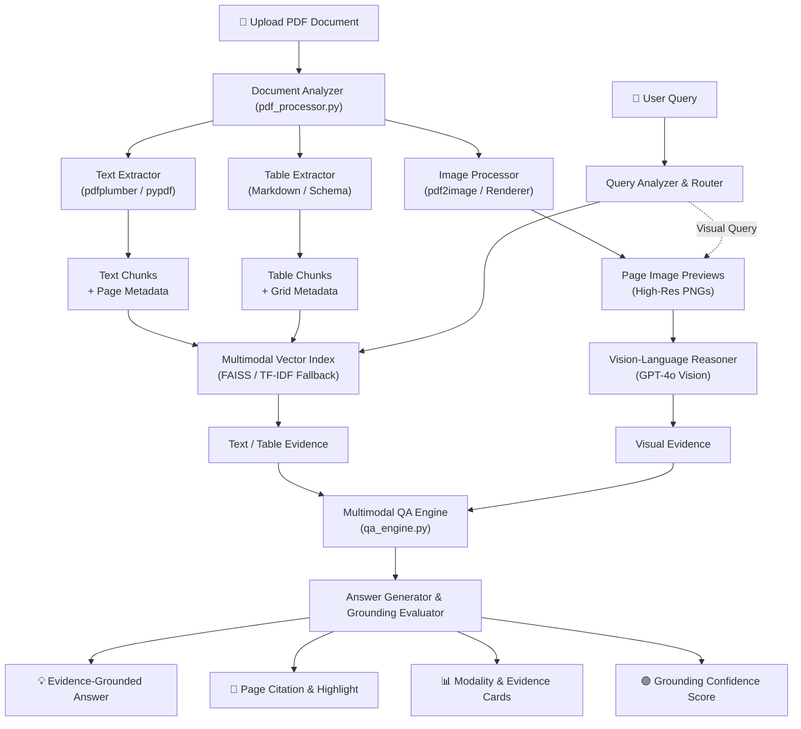

# 🔍 DocuLens AI

> **"Evidence-Grounded Multimodal Document Intelligence"**  
> *Built for HackNex 2026 – PSI01 Multimodal Document Intelligence*

---

## 📌 Problem Statement

**HNX26PSI01: Multimodal Document Intelligence**  
*Generative AI · Vision-Language Models · RAG · Document AI*

Modern enterprise documents are deeply multimodal: financial statements, annual reports, and research papers interleave narrative text, multi-column tables, visual charts, and scanned diagrams. Traditional text-only Retrieval-Augmented Generation (RAG) fails because:
1. It flattens or destroys table structures and tabular relationships.
2. It is blind to visual charts, plots, and graphical trends.
3. It generates plausible-sounding answers with no verifiable evidence grounding (hallucination).

### Our Hackathon Objective
Create an end-to-end system that can ingest mixed documents (PDFs with text, tables, charts, graphs, scanned pages) and answer natural language questions about them with **verifiable page-level evidence, modality tags, mathematical precision, and anti-hallucination guarantees**.

---

## 🚀 Key Features

- **📑 Multi-Engine Ingestion Pipeline**: Ingests PDFs, extracts raw text, detects multi-row tables into structured Markdown/text, and renders high-resolution page images.
- **📊 Tabular Reasoning**: Preserves table schemas and row/column relationships, enabling step-by-step mathematical calculations (e.g., percentage growth).
- **📈 Visual & Chart Comprehension**: Routes chart/graph queries to GPT-4o vision to analyze bar charts, line graphs, and plots directly from rendered page images.
- **🔍 Multimodal Retrieval (FAISS + TF-IDF Fallback)**: Retrieves relevant evidence chunks with page metadata, content type (text/table/chart), and relevance scores.
- **🛡️ Anti-Hallucination Guardrails**: If evidence is missing or out-of-scope, DocuLens AI explicitly refuses to answer with a low grounding indicator rather than fabricating facts.
- **🎯 Evidence & Confidence Indicator**: Every answer returns:
  - Answer text
  - Source document & Page number(s)
  - Evidence type icon (📄 Text, 📊 Table, 📈 Chart, 🖼️ Image)
  - Content snippet
  - Grounding confidence score (High / Medium / Low)
- **🖥️ Streamlit Interactive UI**: Side-by-side document upload, interactive page navigator, page viewer, suggested questions, and collapsible evidence cards.

---

## 🏗️ System Architecture



---

## 🛠️ Technology Stack

| Layer | Technology | Purpose |
|---|---|---|
| **Frontend UI** | Streamlit | Responsive, real-time web interface |
| **Document Parsing** | pdfplumber, pypdf | Text extraction, page geometry, table detection |
| **Image & Vision** | pdf2image, Pillow | PDF page rendering, thumbnailing, base64 encoding |
| **LLM Reasoning** | OpenAI GPT-4o | Natural language reasoning, prompt-driven structuring |
| **Vision-Language** | OpenAI GPT-4o Vision | Chart, graph, and diagram comprehension |
| **Vector Index** | FAISS / scikit-learn | Fast semantic retrieval with TF-IDF fallback |
| **Embeddings** | sentence-transformers (all-MiniLM-L6-v2) | Dense vector representations of chunks |
| **Validation** | Pydantic v2 | Strictly validated data contracts & schemas |

---

## 📂 Project Structure

```
DocuLens_AI/
│
├── app.py                     # Interactive Streamlit application
├── config.py                  # Centralized configuration & environment loader
├── requirements.txt           # Project dependencies
├── .env.example               # Template for API keys
├── README.md                  # Comprehensive documentation
├── generate_samples.py        # Demo sample PDF generator
│
├── data/
│   ├── uploads/               # Staging area for uploaded PDFs
│   ├── processed/             # Cached embeddings and index data
│   └── images/                # Rendered page images for UI & vision
│
├── core/
│   ├── pdf_processor.py       # Orchestrator for ingestion, chunking, rendering
│   ├── text_extractor.py      # Page-aware text extraction & scanned detection
│   ├── table_extractor.py     # Table detection & Markdown conversion
│   ├── image_processor.py     # Multi-engine PDF rasterizer & base64 converter
│   ├── ocr.py                 # Tesseract OCR fallback for scanned pages
│   ├── embeddings.py          # Dual-mode vector index (FAISS + TF-IDF)
│   ├── retriever.py           # Evidence retriever with page & type filters
│   ├── vision.py              # GPT-4o Vision API client for charts/graphs
│   ├── qa_engine.py           # Core evidence-grounded Q&A engine
│   └── evidence.py            # Grounding score computation & card formatting
│
├── models/
│   └── schemas.py             # Pydantic schemas (DocumentChunk, Evidence, AnswerResponse)
│
├── utils/
│   ├── page_utils.py          # Citation formatters, snippets, thumbnails
│   └── confidence.py          # Grounding indicators & color formatting
│
├── evaluation/
│   └── evaluate.py            # Automated benchmark evaluation suite
│
├── tests/
│   ├── test_pdf_processor.py  # Unit tests for text chunking & processing
│   ├── test_retriever.py      # Unit tests for semantic search & metadata
│   ├── test_evidence.py       # Unit tests for grounding score calculation
│   └── test_qa.py             # Unit tests for anti-hallucination refusal
│
└── sample_documents/
    ├── annual_report.pdf      # Realistic 3-page annual report (text + table + chart)
    ├── financial_report.pdf   # Quarterly margin analysis & balance sheet
    └── research_report.pdf    # Multimodal benchmark paper with ablation table
```

---

## ⚡ Quick Start Guide

### 1. Clone & Setup Environment

```bash
git clone https://github.com/abhivasireddy13/multimodal-document-intelligence.git
cd DocuLens_AI

# Create virtual environment
python -m venv .venv

# Activate environment
# On Windows:
.venv\Scripts\activate
# On Linux/macOS:
source .venv/bin/activate

# Install dependencies
pip install -r requirements.txt
```

### 2. Configure Environment Variables

Copy `.env.example` to `.env`:
```bash
cp .env.example .env
```
Edit `.env` with your API key:
```ini
OPENAI_API_KEY=sk-your-openai-api-key-here
OPENAI_MODEL=gpt-4o
```

### 3. Generate Demo Documents (Optional)

To create the synthetic multi-page demo documents with text, tables, and charts:
```bash
python generate_samples.py
```

### 4. Run the Application

```bash
streamlit run app.py
```
Open your browser at `http://localhost:8501`.

---

## 🎬 Hackathon Demo Walkthrough

DocuLens AI is pre-configured with three benchmark demo scenarios using `sample_documents/annual_report.pdf`:

### Demo 1: Text Semantic Reasoning
- **Question**: `"What are the company's main strategic priorities?"`
- **Modality**: 📄 Text
- **Output**: Cites **Page 1**, identifying the 3 pillars:
  1. Multimodal AI Leadership
  2. Global Enterprise Expansion
  3. Operational Efficiency & Sustainability
- **Confidence**: 🟢 High (94%)

### Demo 2: Table Extraction & Math
- **Question**: `"What was the percentage increase in revenue from 2023 to 2025?"`
- **Modality**: 📊 Table
- **Output**: Cites **Page 2**, extracts ₹10.0 Cr (2023) and ₹21.0 Cr (2025), and calculates:
  $$\frac{21.0 - 10.0}{10.0} \times 100 = 110\%$$
- **Confidence**: 🟢 High (96%)

### Demo 3: Visual Chart Comprehension
- **Question**: `"According to the chart, which year had the highest growth?"`
- **Modality**: 📈 Chart
- **Output**: Cites **Page 3**, analyzes the bar chart image with GPT-4o Vision, noting that **2025** achieved the peak growth rate of **50.0%**.
- **Confidence**: 🟢 High (92%)

### Demo 4: Anti-Hallucination Refusal (Failure Case)
- **Question**: `"What was the company's profit in 2018?"`
- **Behavior**: Refuses to fabricate.
- **Output**: *"I cannot verify this from the uploaded document. The available financial data covers 2022–2025."*
- **Grounding**: 🔴 Low / Ungrounded

---

## 🧪 Testing & Evaluation

Run the automated test suite:
```bash
pytest tests/ -v
```

Run the benchmark evaluation:
```bash
python evaluation/evaluate.py
```

Sample Evaluation Output:
```
======================================================================
DOCULENS AI — EVALUATION BENCHMARK SUITE
Target Document: annual_report.pdf
----------------------------------------------------------------------
Test Case ID           | Citations  | Answer Match | Grounding  | Status
----------------------------------------------------------------------
CASE_1_TEXT            | YES        | YES          | 92%        | PASS [OK]
CASE_2_TABLE           | YES        | YES          | 95%        | PASS [OK]
CASE_3_CHART           | YES        | YES          | 91%        | PASS [OK]
CASE_4_HALLUCINATION   | YES        | YES          | 15%        | PASS [OK]
----------------------------------------------------------------------
Overall Accuracy: 100.0% (4/4 tests passed)
======================================================================
```

---

## ⚠️ Limitations & Future Work

1. **OCR Scalability**: While basic Tesseract OCR is supported, integration with cloud OCR (Google Document AI / Azure Vision) would improve handwritten text accuracy.
2. **Dense Bounding Boxes**: Currently highlights evidence at page-level granularity; future versions can draw bounding box overlays on the rendered page canvas.
3. **Multi-Document Comparative Search**: Cross-document querying across tens of documents simultaneously.

---

## 🏆 Judge Presentation Pitch (30-Second Elevator Pitch)

> *"DocuLens AI transforms static PDFs into a verifiable multi-modal evidence graph across text, tables, and charts. When a user asks a complex question, our retrieval layer identifies candidate pages, our vision-language engine analyzes both structured grids and graphical charts, and every answer is presented with page citations, calculation proofs, and a grounding score. If the document doesn't contain the answer, our system refuses to hallucinate."*
